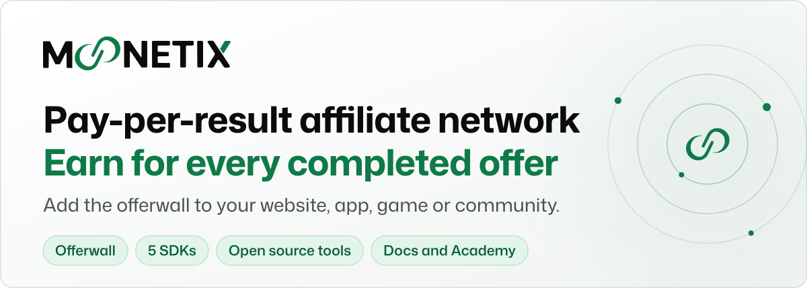
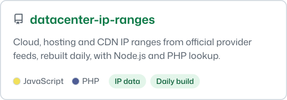
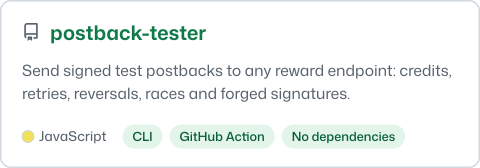
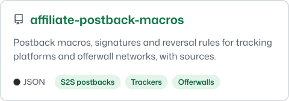
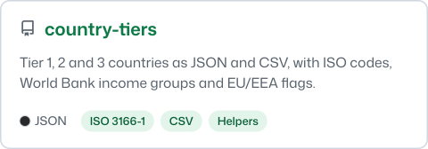
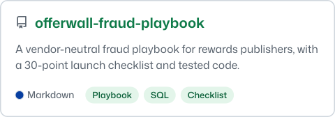
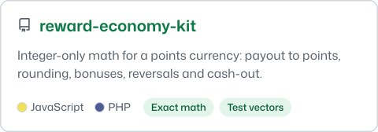
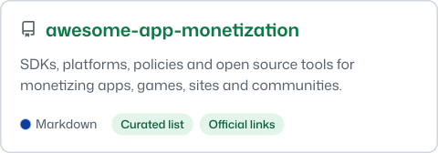
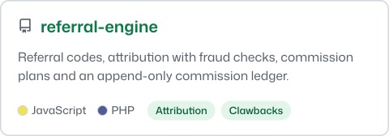

<a href="https://moonetix.com/">
  <picture>
    <source media="(prefers-color-scheme: dark)" srcset="assets/header-dark.svg">
    <source media="(prefers-color-scheme: light)" srcset="assets/header-light.svg">
    
  </picture>
</a>

  
  
  
  

**Moonetix** is a pay-per-result affiliate network for publishers. Add the Moonetix offerwall to your website, app, game or community: your users earn **your own currency** by completing offers, and **you earn for every completed offer**. No banner slots: your users open the offerwall when they want to earn.

- **Plug in anywhere:** signed offerwall link or iframe, floating Earn button, Offers API, Reporting API
- **Native SDKs:** Android, iOS, Unity, Flutter and React Native, with no key shipped inside your app
- **WordPress plugin:** credits a built-in balance, myCred, GamiPress or TeraWallet
- **Safe by design:** HMAC-signed links and postbacks, automatic retries, reversals that carry the original transaction ID
- **Your economy:** your currency name and icon, your rate, your user split, time-limited bonuses

### What we publish here

Running a rewards network means solving the same problems every publisher runs into: telling real users from datacenter traffic, getting postbacks right across a dozen networks, crediting a reward exactly once, keeping a points economy from leaking money. We open source the parts that are useful to everyone, whether or not you work with us.

- **Datasets kept fresh by bots.** IP ranges rebuild every day from official provider feeds, country tiers are reviewed every week, and postback documentation is re-checked against its sources every month. Each change lands as a normal commit you can diff.
- **Libraries with tests in two languages.** Referral attribution, sign-up risk checks, streaks and quests, points math. Each ships in JavaScript and PHP, and both run the same test vectors, so they give the same answer.
- **Reference integrations that run.** Every starter is a complete app with a postback route, a ledger that credits once, and CI that proves it. Clone one, swap in your keys, ship.
- **Guides written from production.** A vendor-neutral fraud playbook and two curated lists, link-checked every week.

Everything is MIT licensed unless the repository says otherwise. Issues and pull requests are welcome, and security reports go through private vulnerability reporting on each repository.

**Star** the repositories you use so you can find them again, and **follow** this account to see new tools and dataset releases in your GitHub feed.

### Featured repositories

<a href="https://github.com/moonetix/datacenter-ip-ranges"><picture><source media="(prefers-color-scheme: dark)" srcset="assets/cards/datacenter-ip-ranges-dark.svg"></picture></a>
<a href="https://github.com/moonetix/postback-tester"><picture><source media="(prefers-color-scheme: dark)" srcset="assets/cards/postback-tester-dark.svg"></picture></a>
<a href="https://github.com/moonetix/affiliate-postback-macros"><picture><source media="(prefers-color-scheme: dark)" srcset="assets/cards/affiliate-postback-macros-dark.svg"></picture></a>
<a href="https://github.com/moonetix/country-tiers"><picture><source media="(prefers-color-scheme: dark)" srcset="assets/cards/country-tiers-dark.svg"></picture></a>
<a href="https://github.com/moonetix/offerwall-fraud-playbook"><picture><source media="(prefers-color-scheme: dark)" srcset="assets/cards/offerwall-fraud-playbook-dark.svg"></picture></a>
<a href="https://github.com/moonetix/reward-economy-kit"><picture><source media="(prefers-color-scheme: dark)" srcset="assets/cards/reward-economy-kit-dark.svg"></picture></a>
<a href="https://github.com/moonetix/awesome-app-monetization"><picture><source media="(prefers-color-scheme: dark)" srcset="assets/cards/awesome-app-monetization-dark.svg"></picture></a>
<a href="https://github.com/moonetix/referral-engine"><picture><source media="(prefers-color-scheme: dark)" srcset="assets/cards/referral-engine-dark.svg"></picture></a>

### All repositories

<b>Browse all 19 repositories by category</b>

**Tools and data for the whole industry**

| Repository | What you get |
| --- | --- |
| [**datacenter-ip-ranges**](https://github.com/moonetix/datacenter-ip-ranges) | Cloud, hosting and CDN IP ranges from official provider feeds, updated daily, with Node and PHP lookup |
| [**postback-tester**](https://github.com/moonetix/postback-tester) | Send signed test postbacks to any reward endpoint: credits, reversals, retries, races, tampered signatures |
| [**affiliate-postback-macros**](https://github.com/moonetix/affiliate-postback-macros) | Postback macros, signatures and reversal rules for 8 tracking platforms and 9 offerwall networks, with sources |
| [**country-tiers**](https://github.com/moonetix/country-tiers) | Tier 1, 2 and 3 countries as JSON and CSV with ISO codes, World Bank income groups and EU/EEA flags |
| [**reward-economy-kit**](https://github.com/moonetix/reward-economy-kit) | Integer-only math for rewards currencies: payout to points, rounding, bonuses, reversals, cash-out |

**Libraries for rewards products**

| Repository | What you get |
| --- | --- |
| [**referral-engine**](https://github.com/moonetix/referral-engine) | Referral codes, attribution with fraud checks, commission plans and an append-only ledger with clawbacks, in JavaScript and PHP |
| [**signup-guard**](https://github.com/moonetix/signup-guard) | Explainable sign-up risk checks: email normalization, disposable domains, datacenter and Tor IPs, velocity limits |
| [**gamification-kit**](https://github.com/moonetix/gamification-kit) | Daily check-ins, streaks, XP levels, quests, leaderboards and caps that stay correct across time zones, in JavaScript and PHP |

**Guides and lists**

| Repository | What you get |
| --- | --- |
| [**offerwall-fraud-playbook**](https://github.com/moonetix/offerwall-fraud-playbook) | A vendor-neutral fraud playbook for rewards publishers, with a 30-point launch checklist and tested code |
| [**awesome-offerwalls**](https://github.com/moonetix/awesome-offerwalls) | Offerwall networks, SDKs, guides, free tools and platform rules in one list |
| [**awesome-app-monetization**](https://github.com/moonetix/awesome-app-monetization) | SDKs, platforms, policies and open source tools for monetizing apps, games, sites and communities |

**Server side**

| Repository | What you get |
| --- | --- |
| [**offerwall-postback-handlers**](https://github.com/moonetix/offerwall-postback-handlers) | Postback handlers in PHP, Node.js, Python and Java: hash check, credit once, reversals |
| [**offerwall-laravel**](https://github.com/moonetix/offerwall-laravel) | Laravel 12 Earn page and postback route |
| [**offerwall-django**](https://github.com/moonetix/offerwall-django) | Django 5.2 Earn page and postback view |
| [**offerwall-express**](https://github.com/moonetix/offerwall-express) | Express 5 on Node 22 with a node:sqlite ledger |

**Websites**

| Repository | What you get |
| --- | --- |
| [**moonetix-offerwall-wordpress**](https://github.com/moonetix/moonetix-offerwall-wordpress) | The official Moonetix Offerwall plugin for WordPress |
| [**offerwall-nextjs-starter**](https://github.com/moonetix/offerwall-nextjs-starter) | A Next.js Earn page with a signed offerwall link and a postback route |

**Apps, games and communities**

| Repository | What you get |
| --- | --- |
| [**telegram-mini-app-offerwall**](https://github.com/moonetix/telegram-mini-app-offerwall) | Telegram Mini App and bot with server-side initData checks |
| [**discord-rewards-bot**](https://github.com/moonetix/discord-rewards-bot) | Discord app with a private /earn command and a coin balance |

### Start in 3 steps

1. [Sign up free](https://moonetix.com/register?from=github-profile) and add your site, app or community.
2. Pick an integration from [the docs](https://docs.moonetix.com) or copy one of the repos above.
3. Credit rewards from the signed postback and test it with the [postback hash checker](https://moonetix.com/tools/postback-hash-checker).

### Install an SDK

| Platform | Add this |
| --- | --- |
| [**Android**](https://docs.moonetix.com/android-sdk) | `implementation("com.moonetix:offerwall:2.0.1")` with `maven { url = uri("https://moonetix.com/maven") }` |
| [**iOS**](https://docs.moonetix.com/ios-sdk) | Swift package `https://moonetix.com/ios/moonetix-ios.git`, library `MoonetixOfferwall` |
| [**Flutter**](https://docs.moonetix.com/flutter-sdk) | `moonetix_offerwall` in `pubspec.yaml` with `hosted: https://moonetix.com/pub` and `version: ^2.0.1` |
| [**React Native**](https://docs.moonetix.com/react-native-sdk) | `@moonetix:registry=https://moonetix.com/npm/` in `.npmrc`, then `npm install @moonetix/react-native-offerwall` |
| [**Unity**](https://docs.moonetix.com/unity-sdk) | Scoped registry `https://moonetix.com/upm` for `com.moonetix`, then `"com.moonetix.offerwall": "2.0.1"` |

Your server creates a short, single-use session and the SDK opens the offerwall with it, so no key ever ships inside your app.

### Links

**Website** [moonetix.com](https://moonetix.com) &nbsp;|&nbsp; **Docs** [docs.moonetix.com](https://docs.moonetix.com) &nbsp;|&nbsp; **Academy** [moonetix.com/academy](https://moonetix.com/academy) &nbsp;|&nbsp; **Free tools** [moonetix.com/tools](https://moonetix.com/tools) &nbsp;|&nbsp; **Contact** [moonetix.com/contact](https://moonetix.com/contact)

**Follow** [X](https://x.com/ofcsharknetwork) &nbsp;|&nbsp; [LinkedIn](https://www.linkedin.com/company/sharknetwork) &nbsp;|&nbsp; [Facebook](https://www.facebook.com/officialsharknetwork) &nbsp;|&nbsp; [Instagram](https://www.instagram.com/officialsharknetwork/)

Ready to add the offerwall? <a href="https://moonetix.com/register?from=github-profile">Create a free publisher account</a>.
